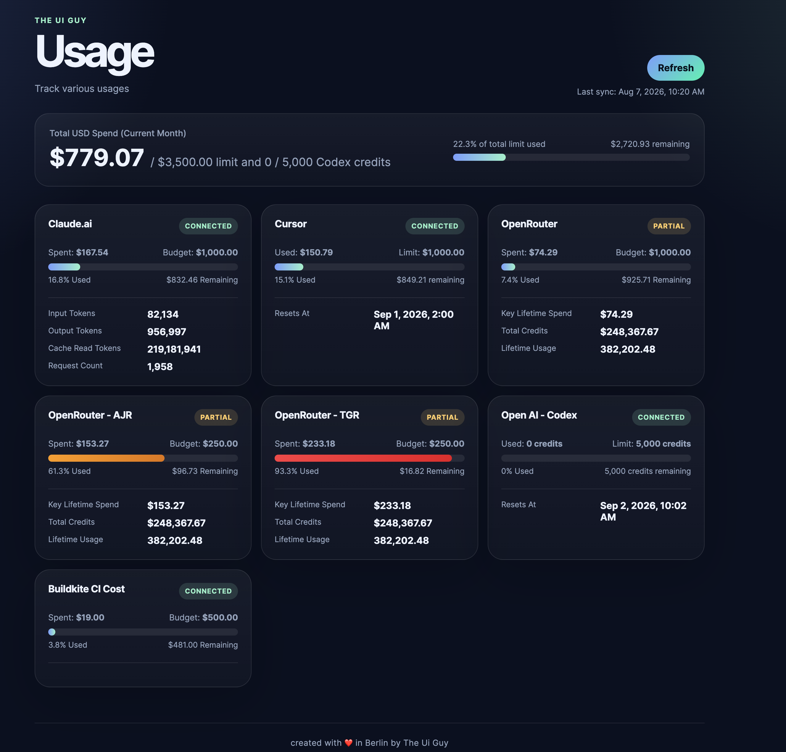

# AI & CI Cost Dashboard 📊



A beautiful, local developer dashboard for tracking all your AI API credit consumption and corporate CI pipeline spend dynamically in real-time.

Created with ❤️ in Berlin by **The Ui Guy**.

---

## 🚀 Features

- 💳 **Total USD Spend Panel**: Prominently aggregates all cash expenses (OpenRouter, Cursor, Claude) and credit counters (Codex) into a single, unified banner at the top.
- 🚦 **Color-Coded Progress Bars**: Automatically transitions progress fills based on budget utilization:
  - **Cyan/Blue**: `< 50%` used
  - **Yellow/Amber**: `50% - 79%` used (Warning)
  - **Red/Crimson**: `≥ 80%` used (Urgent)
- 🔑 **Standardized OpenRouter Key Tracking**: Support for tracking up to **3 separate OpenRouter API keys** simultaneously:
  - Primary: `OpenRouter` (Default standard environment variables)
  - Secondary: `OpenRouter - AJR` (`_1` suffix)
  - Tertiary: `OpenRouter - TGR` (`_2` suffix)
- 🍪 **Claude & Cursor Browser Sync**: Dynamically queries in-browser account summaries via standard cookies and request authorization, bypassing the lack of developer APIs.
- 🔎 **Elasticsearch ES|QL Sync**: Live queries your Elasticsearch indices via custom ES|QL aggregations to calculate real-time Buildkite agent run costs for your repository fork.
- 🛡️ **Zero Key Leaks**: Private credential variables are stored strictly in `.env`, and all cached usage summaries in `data/*.json` are completely gitignored.

---

## 🛠️ Configuration

Copy `.env.example` into a new file called `.env` and configure your credentials:

```bash
cp .env.example .env
```

### 1. OpenRouter

Configure up to **3 API Keys** on your dashboard:

- **Primary Key (`OpenRouter`)**: Uses `OPENROUTER_API_KEY` and optional `OPENROUTER_MONTHLY_BUDGET_USD` (Defaults to `$1,000.00` limit).
- **Secondary Key (`AJR`)**: Uses `OPENROUTER_API_KEY_1` and optional `OPENROUTER_MONTHLY_BUDGET_USD_1` (Defaults to `$500.00` limit).
- **Tertiary Key (`TGR`)**: Uses `OPENROUTER_API_KEY_2` and optional `OPENROUTER_MONTHLY_BUDGET_USD_2` (Defaults to `$500.00` limit).

### 2. Open AI - Codex (ChatGPT Enterprise)

1. Log into your company's ChatGPT account and open your browser's Developer Tools (Network Tab).
2. Go to **Settings > Usage** to load your monthly credits limit.
3. Find the network request to `backend-api/accounts/.../spend-controls` and copy:
   - **`cookie`**: Paste into `CHATGPT_ENTERPRISE_COOKIE`.
   - **`authorization`**: Paste into `CHATGPT_ENTERPRISE_AUTHORIZATION` (Bearer JWT).
4. Set `CHATGPT_ENTERPRISE_ACTIVE=true`.

### 3. Cursor

1. Open Cursor's settings/usage page in your browser.
2. In the Network Tab, locate the request to `api/usage-summary?teamId=...` and copy:
   - **The request URL**: Paste into `CURSOR_API_URL`.
   - **`cookie`**: Paste into `CURSOR_COOKIE`.
3. Set `CURSOR_ACTIVE=true` (Defaults to `$1,000.00` limit fallback).

### 4. Claude.ai

1. Open your Claude.ai account settings usage dashboard in your browser.
2. In the Network Tab, locate the request to `api/organizations/.../usage/spend` and copy:
   - **The request URL** (with your organization ID): Paste into `CLAUDE_API_URL`.
   - **`cookie`**: Paste into `CLAUDE_COOKIE`.
3. Configure your monthly budget in `CLAUDE_MONTHLY_BUDGET_USD` (e.g. `1000`) and set `CLAUDE_ACTIVE=true`.

### 5. Buildkite CI Cost

Allows querying Buildkite stats stored in an Elasticsearch cluster:

- **`BUILDKITE_ES_URL`**: Your direct Elastic Cloud Elasticsearch endpoint (e.g., `https://...es.us-central1.gcp.cloud.es.io`).
- **`BUILDKITE_ES_API_KEY`**: Your standard cluster API Key.
- **`BUILDKITE_REPO_NAME`**: Set to your exact fork (e.g., `git://github.com/achyutjhunjhunwala/kibana.git`).
- **`BUILDKITE_ACTIVE=true`** (Defaults to `$500.00` limit fallback).

---

## 💻 Development

Install dependencies and run the Next.js development server locally:

```bash
npm install
npm run dev
```

Build the optimized Next.js production server locally:

```bash
npm run build
npm run start
```

Verify your code styles, typing accuracy, and bundler compliance before pushing:

```bash
npm run check
```
