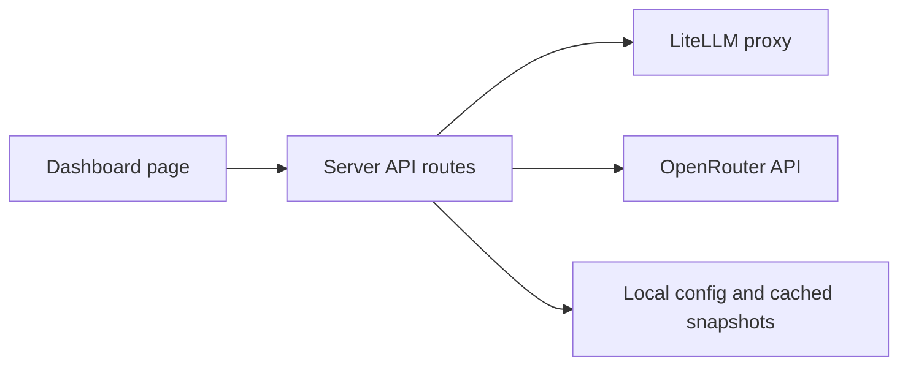

# AI Usage Dashboard Plan

## Goal

Create a simple one-page dashboard that shows monthly AI usage, cost, remaining budget, and data freshness across:

- LiteLLM API key
- OpenRouter API key

The first version should be a read-only dashboard. It should not try to manage provider accounts, change budgets, or mutate provider settings.

## Core Dashboard View

The dashboard should show:

- Total monthly budget across all providers
- Total current month spend
- Remaining monthly budget
- Percentage of budget used
- Projected month-end spend
- Last successful sync time
- Per-provider status: connected, partial, not configured, or sync error

Each provider should have its own card:

- Provider name
- Monthly budget
- Current month spend
- Remaining budget
- Usage percentage progress bar
- Token usage, when available
- Request count, when available
- Most-used models, when available
- Last synced timestamp
- Short setup warning if full API data is unavailable

Below the cards, include:

- Daily spend chart for the current month
- Provider comparison chart
- Model breakdown table
- Setup guidance for providers that are not configured yet

## Provider Feasibility

### LiteLLM

LiteLLM is feasible if the LiteLLM proxy has spend tracking enabled with a database.

Useful endpoints:

- `GET /daily_metrics`
- `GET /user/daily/activity?start_date=YYYY-MM-DD&end_date=YYYY-MM-DD`
- `GET /spend/logs?start_date=YYYY-MM-DD&end_date=YYYY-MM-DD`
- `GET /global/spend/report?start_date=YYYY-MM-DD&end_date=YYYY-MM-DD`

The dashboard should start with `daily_metrics` or `user/daily/activity`, depending on which route the available API key can access.

Expected data:

- Daily spend
- Total spend
- Spend by model
- Spend by API key
- Prompt, completion, and total tokens if using detailed activity endpoints

Budget source:

- Manual monthly budget entered in dashboard settings, unless LiteLLM budgets are configured and accessible.

### OpenRouter

OpenRouter is feasible for account-level credit tracking with a Management API key.

Useful endpoint:

- `GET https://openrouter.ai/api/v1/credits`

Expected response includes:

- Total credits purchased
- Total credits used

OpenRouter also returns usage information in API responses, including prompt tokens, completion tokens, total tokens, and cost. However, historical monthly breakdown may require the dashboard to store usage going forward, unless a historical account usage endpoint is available for the account.

MVP behavior:

- Show total credits, used credits, and remaining credits.
- Treat credits as USD-equivalent if OpenRouter account credits map directly to dollars.
- Store daily snapshots locally so the dashboard can build a trend over time.

Budget source:

- Total credits from OpenRouter.
- Optional manual monthly budget override.

## MVP Provider Statuses

Each provider should have one of these statuses:

- `connected`: API key is configured and latest sync succeeded.
- `partial`: Provider is connected but cannot fully calculate current-month usage yet.
- `not_configured`: Required environment variables are missing.
- `error`: Sync failed.

Cursor and Claude are excluded because employee-level credentials cannot provide useful automated usage data.

## Recommended Architecture

Use a small app with a server-side API layer. Provider secrets should never be exposed in browser code.



Recommended stack:

- Next.js for the app and API routes
- TypeScript
- Plain CSS for a fast dashboard UI
- Local JSON snapshots for OpenRouter monthly deltas
- Environment variables for provider keys

Alternative simpler stack:

- Vite React frontend
- Small Express server
- Local JSON file

Next.js is the preferred option because it keeps the one-page UI and server-only provider adapters in one project.

## Configuration

Use server-only environment variables:

```bash
LITELLM_BASE_URL=
LITELLM_API_KEY=
OPENROUTER_API_KEY=
LITELLM_MONTHLY_BUDGET_USD=
OPENROUTER_MONTHLY_BUDGET_USD=
```

## Data Model

Normalize all providers into one shape so the dashboard UI does not care where the data came from.

```ts
type ProviderId = 'litellm' | 'openrouter';

type ProviderStatus = 'connected' | 'not_configured' | 'partial' | 'error';

type ProviderUsage = {
  provider: ProviderId;
  displayName: string;
  billingPeriodStart: string;
  billingPeriodEnd: string;
  budgetUsd: number | null;
  spendUsd: number | null;
  remainingUsd: number | null;
  percentUsed: number | null;
  projectedMonthEndSpendUsd: number | null;
  promptTokens?: number;
  completionTokens?: number;
  cacheReadTokens?: number;
  cacheWriteTokens?: number;
  totalTokens?: number;
  requestCount?: number;
  dailySpend: Array<{
    date: string;
    spendUsd: number;
  }>;
  modelBreakdown?: Array<{
    model: string;
    spendUsd: number;
    totalTokens?: number;
  }>;
  source: 'api' | 'derived';
  status: ProviderStatus;
  lastSyncedAt?: string;
  message?: string;
};
```

## Provider Adapter Interface

Each provider should implement the same server-side interface.

```ts
type ProviderAdapter = {
  id: ProviderId;
  syncCurrentMonth(): Promise<ProviderUsage>;
};
```

Suggested adapters:

- `litellmAdapter`
- `openrouterAdapter`

## MVP Implementation Steps

1. Create the Next.js app shell with one dashboard route.
2. Add static mock data for the two provider cards.
3. Build the summary strip, provider cards, spend chart, and provider details table.
4. Add the normalized `ProviderUsage` type.
5. Add provider adapter interface and server API route: `GET /api/usage/current-month`.
6. Implement LiteLLM sync.
7. Implement OpenRouter credit sync.
8. Add local OpenRouter snapshots so monthly deltas can be derived after repeated syncs.
9. Add refresh button and last-sync display.
10. Add error states for invalid keys, missing configuration, and unavailable endpoints.

## MVP Scope

Include:

- One dashboard page
- Current-month usage only
- Manual refresh
- Budget configuration through environment variables
- API-backed LiteLLM and OpenRouter
- Basic charts and provider cards

Exclude from MVP:

- Multi-user auth
- Alerts
- Email reports
- CSV export
- Historical analytics beyond current month
- Provider account management
- Budget editing through provider APIs
- Public deployment
- Manual tracking for providers without useful APIs

## Later Enhancements

Possible future improvements:

- Daily scheduled sync
- Spend alerts
- Slack notifications
- Forecasting based on trailing 7-day usage
- Historical month selector
- Per-model drilldown
- Per-project or per-user breakdown
- Hosted deployment behind authentication

## Key Risks

- OpenRouter may provide reliable credit totals but not detailed historical monthly usage unless usage is captured by this app going forward.
- LiteLLM spend accuracy depends on proxy configuration, model pricing data, and database-backed tracking.

## First Version Recommendation

Build the first version as a local Next.js dashboard with:

- Fully connected LiteLLM integration
- Fully connected OpenRouter credits integration

This gives a useful dashboard immediately with the keys already available and avoids fake manual tracking for providers that cannot be automated.
